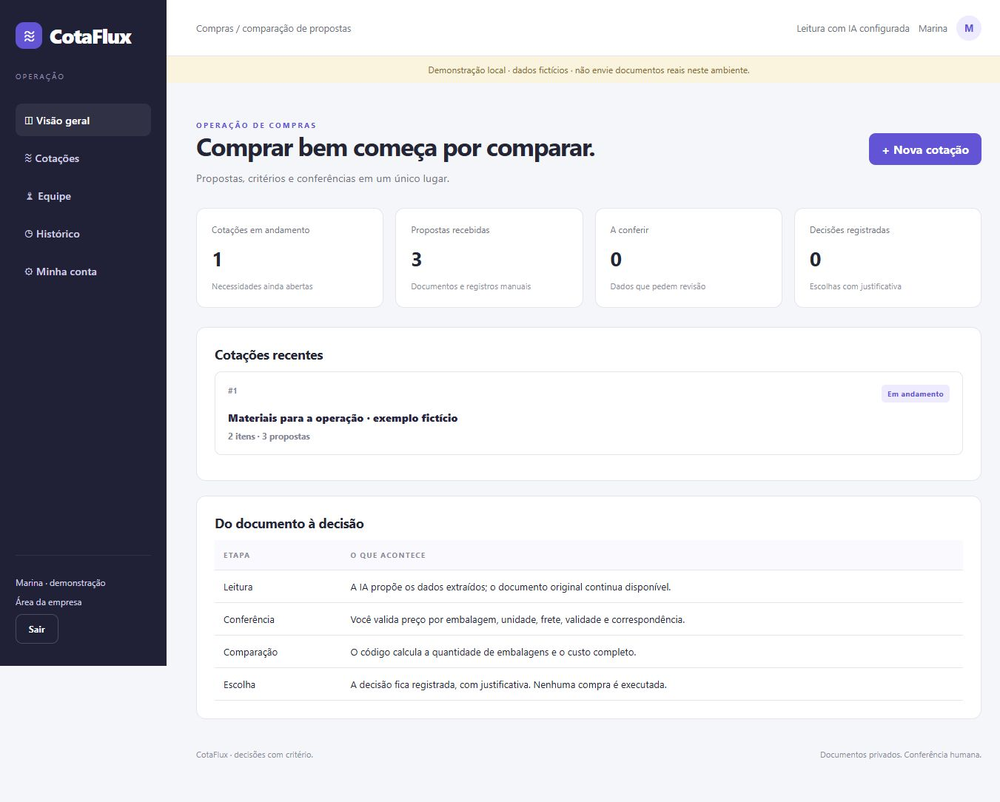
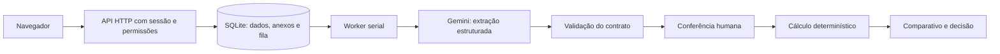

# CotaFlux

**Compare propostas de fornecedores sem misturar preço unitário, embalagem e custo da compra.** Uma aplicação web cliente-servidor que usa IA para sugerir a leitura dos documentos e regras explícitas para calcular a comparação após conferência humana.



[Comparação de propostas](docs/comparacao.png) · [Layout móvel](docs/mobile.png)

## O problema

Uma pequena operação recebe propostas em PDFs, fotos e mensagens. Um fornecedor vende pacotes de 100 unidades; outro, caixas de 1.000. Frete e validade podem estar ausentes. Transcrever tudo e comparar somente o preço aparente produz retrabalho e decisões pouco transparentes.

O CotaFlux reúne a necessidade de compra, as propostas originais, os campos extraídos e a decisão. Ele não presume que descrições parecidas representam produtos equivalentes.

## O que está implementado

- Cadastro de cotações com múltiplos itens, quantidade e unidade base (`un`, `kg`, `l`).
- Propostas por fornecedor, com arquivo PDF, JPG, PNG, TXT ou texto colado; registro manual também disponível.
- Leitura real por Gemini, em fila persistente no SQLite, com autorização por documento.
- Conferência de descrição, preço por embalagem, quantidade por embalagem, unidade, prazo, validade e frete.
- Vinculação manual entre o item ofertado e a necessidade da compra; cada equivalência precisa ser confirmada.
- Comparação da cesta completa, incluindo arredondamento para embalagens inteiras e frete uma única vez.
- Bloqueio do ranking para propostas vencidas, não conferidas, incompletas ou com unidades incompatíveis.
- Registro da escolha com justificativa e encerramento que impede novas alterações na cotação.
- Cópia dos valores e linhas comparadas na decisão, preservando o histórico da escolha.
- Exportação CSV, usuários compradores, administração da equipe, histórico e backup online.
- Prévia privada de imagens e textos no painel para conferir o original; PDFs continuam disponíveis por download.

### Exemplo de cálculo

Para 1.000 unidades, com pacote de 100 por R$ 18,90 e frete de R$ 35,00:

`10 pacotes × R$ 18,90 + R$ 35,00 = R$ 224,00`.

O cálculo usa centavos inteiros. Quantidades base admitem até seis casas decimais; a divisão evita comprar uma embalagem extra por imprecisão de ponto flutuante. Não há conversão implícita entre kg, litro e unidade.

No exemplo da interface, uma cesta de copos e café aparece por **R$ 480,00**, **R$ 484,00** e **R$ 490,00**, conforme os dados fictícios conferidos. Isso demonstra o cálculo; não é uma alegação de economia real obtida por uma empresa.

## Como experimentar

Requisito: **Node.js 24 LTS**. Não há dependências npm de runtime nem instalação obrigatória de pacotes. Na pasta do projeto, execute:

```sh
npm run demo
```

Abra **http://127.0.0.1:3060** e clique em **Entrar como empresa**. A demonstração usa pessoas e propostas fictícias. O acesso por botão só existe quando `DEMO=true`; ele não deve ser exposto publicamente ou usado para dados reais.

1. Abra a cotação de exemplo e confira o comparativo.
2. Adicione uma proposta e anexe um arquivo ou cole o texto recebido.
3. Marque a autorização e clique em **Ler documento com IA**.
4. Compare os campos com o original. Vincule cada item e confirme a equivalência.
5. Salve a conferência. Pendências continuam visíveis; elas não são convertidas em valores inventados.
6. Compare as propostas e, quando desejar, registre a escolha com justificativa.

Sem chave, cadastro, preenchimento manual, cálculo e exportação funcionam. A tentativa de leitura explica a falta da configuração; não há resposta de IA simulada.

## Instalação própria

Copie `.env.example` para `.env`, configure sua própria chave e uma pasta de dados privada:

```dotenv
GEMINI_API_KEY=sua_chave_somente_no_arquivo_local
GEMINI_MODEL=gemini-3.1-flash-lite
GEMINI_VISION_MODEL=gemini-3.5-flash-lite
DATA_DIR=./data/real
DEMO=false
```

```sh
npm start
```

Na primeira abertura, crie o acesso da empresa com senha de pelo menos 12 caracteres. Não existe senha padrão de produção. O administrador cadastra compradores pela área Equipe e entrega a senha inicial por canal privado. A troca de senha própria está disponível em Minha conta e encerra outras sessões. Recuperação de senha e MFA ainda não estão implementadas; não exponha uma instalação real antes de adequar a gestão de identidades.

O adaptador também aceita `LLM_API_KEY` como variável de compatibilidade em uma configuração privada existente. Esse arquivo externo e a chave do desenvolvedor não acompanham o repositório. Cada instalação deve usar sua própria conta do provedor.

### Docker

`docker compose up --build` disponibiliza uma instalação vazia em **http://localhost:3060**, com volume próprio. Configure a chave no ambiente. O compose restringe a porta ao loopback. A receita está incluída, mas a execução em Docker não foi homologada nesta entrega; a validação funcional foi feita com Node no Windows.

Para uso remoto, utilize domínio, proxy HTTPS, `APP_ORIGIN` exato e `SECURE_COOKIES=true`, com demonstração desligada. Nenhum servidor público, domínio ou regra de firewall foi criado.

## Onde os dados ficam

`DATA_DIR/app.sqlite` contém usuários, sessões, cotações, propostas, anexos, tarefas e eventos. O padrão sem configuração é `./data`; a demonstração via `npm run demo` usa `./data/demo`. Não misture a pasta demonstrativa com a instalação real.

O comando de demonstração usa `DEMO_DATA_DIR`, independente de `DATA_DIR`. O banco registra o modo e o produto da instalação e recusa abertura por outro modo ou aplicativo. Assim, uma pasta de dados reais não ganha o acesso demonstrativo sem senha por uma troca de configuração. No Windows, você pode escolher uma pasta externa como `D:/DadosProjetos/cotaflux-real`.

Os anexos são BLOBs privados no SQLite, sem URLs públicas estáticas. Os limites atuais são 8 MB por arquivo e 500 documentos por instalação. Uma instalação representa uma empresa; compradores compartilham as cotações dessa empresa. Não há isolamento de várias empresas no mesmo banco.

```sh
npm run backup -- ./backups
```

O comando copia a base apontada por `DATA_DIR`; para salvar uma demonstração, aponte essa variável explicitamente para a pasta demonstrativa. O backup usa a API online do SQLite, inclui anexos e confere integridade. Para restaurar, pare o servidor, preserve a pasta atual, use uma pasta nova e copie o backup como `app.sqlite`; depois aponte `DATA_DIR` para ela. Não substitua bancos enquanto o aplicativo estiver aberto. Nunca envie banco, backup, CSV privado ou `.env` ao GitHub.

## Arquitetura



O modelo não decide equivalência, não aprova propostas, não faz contas de fechamento e não compra. Os campos propostos pela IA permanecem separados dos campos conferidos. Alterações têm versão; uma leitura atrasada não substitui uma edição mais recente. Falhas preservam o arquivo e permitem preencher manualmente ou solicitar nova leitura.

Textos usam o modelo configurado em `GEMINI_MODEL`; fotos e PDFs usam `GEMINI_VISION_MODEL`. Essa separação surgiu de uma falha real no ensaio de visão. A disponibilidade e os custos dependem da conta e do modelo escolhido.

## Testes e resultados

```sh
npm test
npm run evaluate:ai
```

Os testes determinísticos cobrem contas, equivalências, sessões, CSRF, permissões, versões, transações, anexos e falhas do provedor. Os ensaios de IA usam documentos fictícios e registram campos esperados, resposta e erros em `docs/ai-*.json`; não são um benchmark independente nem uma promessa de acurácia geral.

Na revisão da versão **0.1.1**, passaram **28 testes**, incluindo isolamento entre modo real e demonstrativo e bloqueio de reutilização do banco por outro produto. A receita Docker e o workflow de CI estão incluídos; a execução validada nesta revisão foi local, no Windows com Node.js 24.

Confira [resultados e limites](docs/VALIDACAO.md), [arquitetura e decisões](docs/ARQUITETURA.md), [contrato da API](docs/API.md), [escopo e próximos passos](docs/ESCOPO.md) e [segurança](SECURITY.md).

## Licença e desenvolvimento

Licenciado sob [MIT](LICENSE). Cada instalação configura sua própria chave de IA. Os exemplos incluídos são fictícios; bancos de dados, comprovantes privados e credenciais não fazem parte da distribuição.

Desenvolvido por [BernardoReges](https://github.com/BernardoReges), com assistência de IA. A infraestrutura inicial de autenticação, persistência e extração é compartilhada com o Rota Recibos; os domínios e testes de negócio são separados. Contribuições são descritas em [CONTRIBUTING.md](CONTRIBUTING.md).
