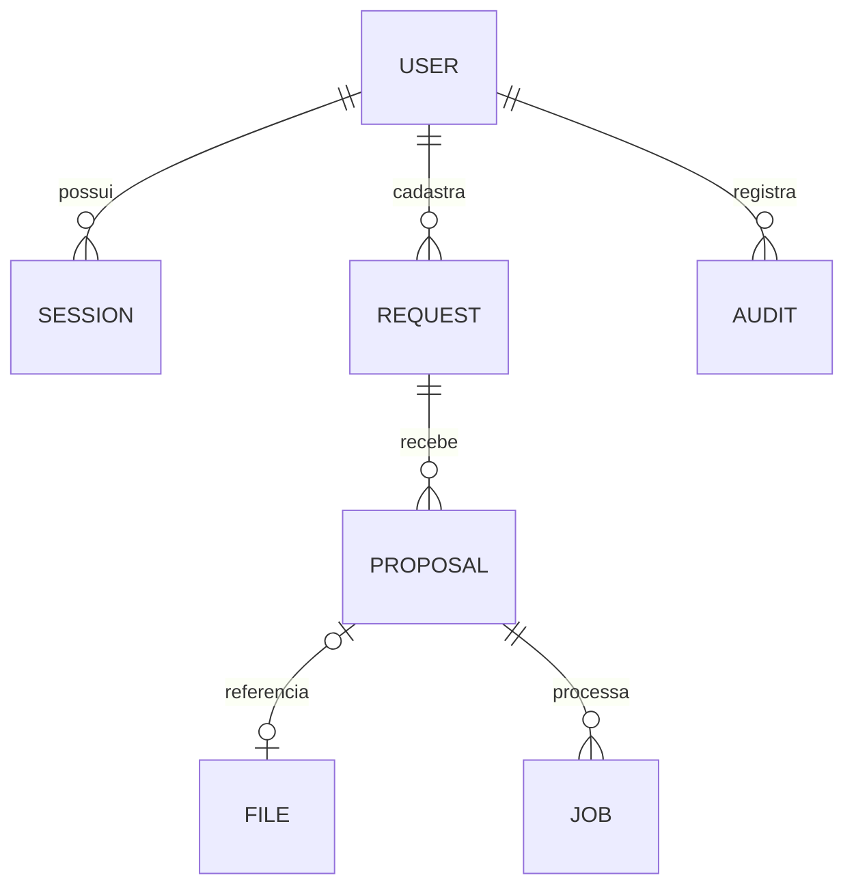

# Arquitetura e decisões

## Componentes

| Camada       | Arquivos                                | Responsabilidade                                                  |
| ------------ | --------------------------------------- | ----------------------------------------------------------------- |
| Cliente      | `public/app.mjs`, `ui.mjs`, `style.css` | Formulários, comparação, conferência e navegação responsiva       |
| Transporte   | `src/http.mjs`                          | Sessões, origem, limites de corpo e roteamento                    |
| Regras       | `src/domain.mjs`                        | Cotações, validação de propostas, equivalência, cálculo e decisão |
| Persistência | `src/core.mjs`                          | SQLite, transações, números sequenciais, anexos e credenciais     |
| Extração     | `src/ai.mjs`, `contracts.mjs`           | Provedor, esquema estruturado e validação da resposta             |
| Operação     | `scripts/backup.mjs`, `evaluate-ai.mjs` | Backup e ensaios reproduzíveis                                    |

## Decisões técnicas

**Node 24 e navegador sem framework.** A primeira instalação não depende de um conjunto extenso de pacotes. O objetivo é permitir leitura do fluxo de ponta a ponta. Um frontend maior pode justificar componentes e build próprios no futuro.

**SQLite e anexos BLOB.** Mantém os registros e arquivos juntos no backup, com transação no cadastro do documento. Evita arquivo órfão se a criação da proposta falhar. A troca é um banco maior; não há streaming ou armazenamento de objetos nesta versão. Os limites são explícitos.

**Registros de domínio em JSON dentro de tabela indexada por ID e tipo.** Adequado ao protótipo funcional, com validação no servidor. Não representa um modelo relacional completo: referências dentro do JSON não têm foreign keys de banco. Para volume e relatórios complexos, migrar para tabelas de domínio normalizadas e migrações versionadas.

**Fila persistida e worker serial.** O pedido de leitura fica no banco. Não há chamadas paralelas ilimitadas. Uma tarefa em execução interrompida vira falha ao reiniciar, permitindo nova tentativa explícita e evitando repetir custos silenciosamente. A unicidade da tarefa ativa impede duplicidade enquanto ela está em andamento. O limite de leituras por pessoa é mantido em memória e reinicia com o processo.

**Campos extraídos e conferidos separados.** A IA fornece um rascunho. O salvamento da conferência usa contrato próprio; dados desconhecidos não viram preço zero. A confirmação de equivalência exige ação humana.

**Versão otimista.** Edições obsoletas recebem conflito. Antes de aplicar uma leitura, o worker verifica se o registro ainda é da versão analisada.

**Decisão preservada.** O encerramento guarda o fornecedor, total e linhas do comparativo. Uma leitura que retorna após o fechamento é recusada; a passagem do tempo não recalcula os valores da decisão como se fossem uma cotação nova.

**Cálculo independente da IA.** Embalagens são arredondadas para cima após conversão das quantidades para escala de seis casas decimais. Preços e totais usam centavos inteiros. Ranking só compara propostas elegíveis.

**Sessão do servidor.** Senhas com scrypt; tokens com hash e validade, cookies HttpOnly e SameSite=Strict. O nome do cookie é específico do produto, evitando conflito com Rota Recibos no mesmo computador. Uma troca de senha revoga sessões anteriores.

## Modelo de dados

O diagrama representa as relações de domínio, não todas as restrições físicas no SQLite. Identificadores internos são aleatórios; os números visíveis são sequenciais e persistidos.

## Limites operacionais

Não há criptografia do banco, multiempresa, antivírus de anexos, observabilidade central, recuperação de senha ou garantia de disponibilidade do provedor. Nenhuma conta de desenvolvedor é necessária para usar o preenchimento manual. O ambiente demonstrativo é local e deve usar somente documentos fictícios.

As bases de infraestrutura do CotaFlux e do Rota Recibos foram desenvolvidas em conjunto e são semelhantes. Os domínios, permissões específicas, interfaces e testes de negócio são independentes. Isso deve ser informado ao apresentar os dois projetos; não se trata de duas arquiteturas totalmente distintas.
